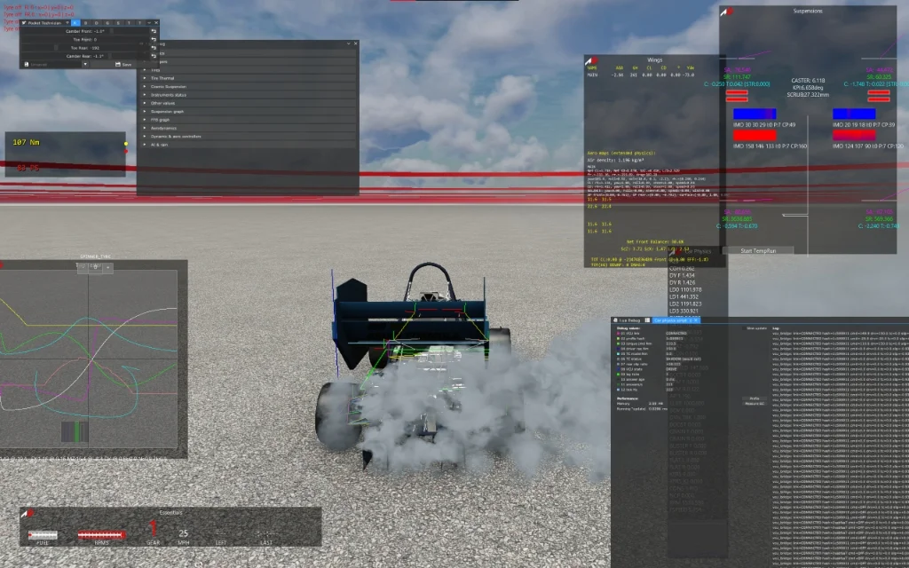
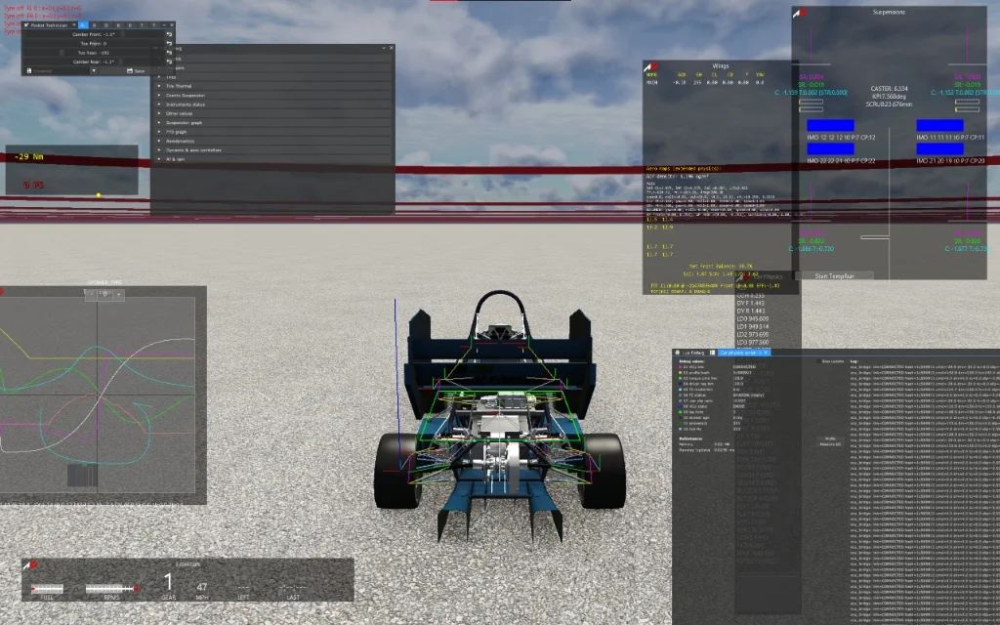
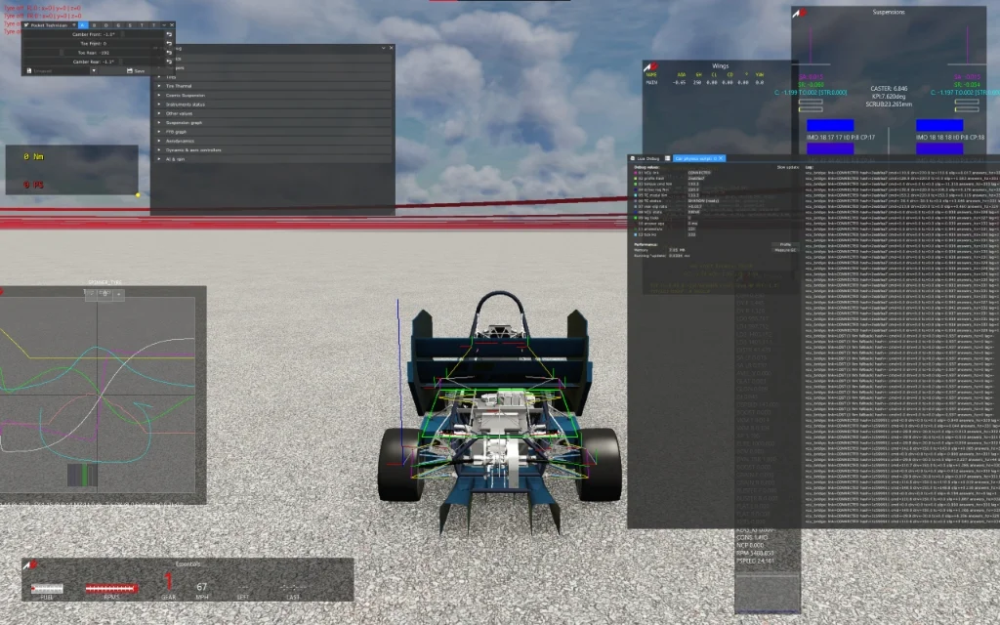
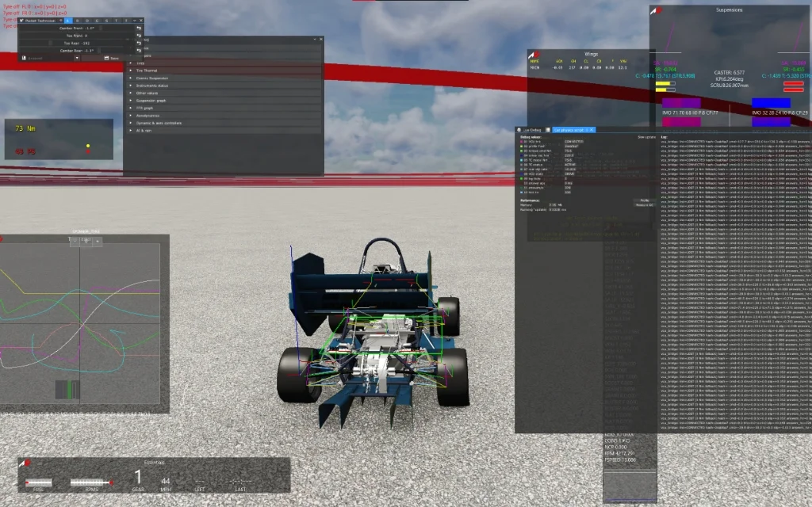

# MK12 SIL VCU: Validation Results

## v0.1.0 — 2026-11-23

**Passed.** Run on 2026-11-23 by Tyler on Windows with Assetto Corsa and CSP `v0.3.0-preview675/4210`,
following [TEST_GUIDE.md](TEST_GUIDE.md), against `bfr_vcu` (`mk12-vcu` commit `9fc0d92`) and the
bundled `bfr_mk12` car script. All four driven sessions (~9 minutes / 53,939 rows of 100 Hz CSV
telemetry), the CSP log, screenshots, and a custom Profile Studio YAML export were validated.

> **Input caveat:** This session was driven on **keyboard** (binary 0%/100% throttle). All bridge,
> firmware, power-cap, regen, brake-cancel, and TC telemetry checks are verified quantitatively from
> the 100 Hz logs; subjective pedal feel, `-30 Nm` lift-off regen, and brake-cancel feel remain to
> be evaluated on the pedal rig.

---

### Checklist

| Check | Result | Pass? |
|---|---|---|
| CSP version | `v0.3.0-preview675/4210` (0 Lua errors) | — |
| `12 tick Hz` / `11 answers/s` | `333 Hz` / `331–334` (median `333`) | ✅ |
| `09 lag ticks` / `10 answer age` | `1` tick steady (100% of samples) / `0 ms` | ✅ |
| Lua physics overhead (`Running "update"`) | `0.027–0.034 ms` (~1% of 3 ms tick), no FPS drop | ✅ |
| Step 1: `base.yaml` (150 Nm, shadow TC) | Hash `1c599911`, `149.9 Nm` cmd, `SHADOW (would cut)` on wheelspin | ✅ |
| EV.3.3.1 power cap (`75 kW × 0.85 = 63.75 kW`) | `63.75–63.88 kW` held across 3000–5544 rpm (`~110.5 Nm` @ 5500 rpm) | ✅ |
| Lift-off regen (`-30 Nm`) & `6 → 5 km/h` fade | `-29.9 Nm` steady; fades `-29.9 → 0.0 Nm` across `6.2 → 4.96 km/h` | ✅ |
| Brake cancel (>5% brake) | `0.0 Nm` immediately on **368 / 368** braking rows (>10 km/h) | ✅ |
| Step 2: Fail-closed fallback (`bfr_vcu.exe` closed) | `LOST (0 Nm fallback)`, `cmd=0.0`, `answers_hz=0` | ✅ |
| Step 2: Mid-session switch to `main_220nm.yaml` | Auto-reconnected as `2eabfaa7`, reached `219.9 Nm` without restart | ✅ |
| Clutch slip at 220 Nm (`MAX_TORQUE=250`) | Drivetrain ratio `3.90–3.91` (`GEAR_1 = 3.909`) at low & >130 Nm | ✅ |
| Step 3: Live Simulink TC (`--tc-active`) | `READY → ACTIVE`, smooth torque cuts, `0–50 km/h` in `2.04–2.05 s` | ✅ |
| Custom YAML from Profile Studio | Expo 220 Nm map (`hash f3aceba9`) loaded and drove cleanly | ✅ |
| Step 4: `--sleep` mode | Not run (default spinning loop had zero FPS impact) | — |

---

### Telemetry Runs (100 Hz CSV)

Raw CSVs and [custom_shaders_patch.log](results/v0.1.0/logs/custom_shaders_patch.log) are archived in [`results/v0.1.0/logs/`](results/v0.1.0/logs/).

| Log file | Profile (hash) | TC mode | Sim time | Rows | Max speed / RPM | Highlights |
|---|---|---|---:|---:|---|---|
| [vcu_base_20261123_163029.csv](results/v0.1.0/logs/vcu_base_20261123_163029.csv) | `base` (`1c599911`) | `shadow` | 240.6 s | 24,061 | 107.2 km/h / 5544 | 150 Nm pull, `-29.9 Nm` regen, `6→5 km/h` fade, 104 brake-cancel rows, smoky burnouts (`slip` up to `60.0`) |
| [vcu_main_220nm_20261123_163651.csv](results/v0.1.0/logs/vcu_main_220nm_20261123_163651.csv) | `main_220nm` (`2eabfaa7`) | `shadow` | 161.0 s | 16,105 | 107.2 km/h / 5518 | Mid-session swap from `base`, 220 Nm pull, power cap taper from 2770 rpm, 120 brake-cancel rows |
| [vcu_main_220nm_20261123_164051.csv](results/v0.1.0/logs/vcu_main_220nm_20261123_164051.csv) | `main_220nm` (`2eabfaa7`) | `active` | 97.2 s | 9,717 | 93.4 km/h / 4950 | Live TC launches (`0–50` in `2.04 s`, `0–70` in `2.73 s`), smooth cornering cuts, 144 brake-cancel rows |
| [vcu_main_220nm_20261123_164410.csv](results/v0.1.0/logs/vcu_main_220nm_20261123_164410.csv) | `main_220nm` (`2eabfaa7`) | `active` | 40.6 s | 4,056 | 75.9 km/h / 4556 | Standing WOT launch (`0–50` in `2.05 s`, `0–70` in `2.76 s`), steady `0.14–0.24` slip tracking into corner |

*(Three additional 0-row CSVs were created while `bfr_vcu.exe` was started/switched with the car in Neutral.)*

#### Key Quantitative Checks

- **333 Hz timing & CSV cadence:** Normal 100 Hz CSV spacing averaged `10.06–10.09 ms` (`p50 = 9 ms`, `p99 = 13 ms`, matching the 3-3-4 AC-tick cadence of `333 Hz → 1 kHz → 100 Hz`). Wheel angular velocities from `ac.accessCarPhysics().wheels` updated on `99.6–100%` of CSV rows, with an effective front tire diameter of `16.0 in` (`0.203 m` radius).
- **Power cap (EV.3.3.1):** Full-throttle `cap_nm` stayed locked to `63.75–63.88 kW` mechanical across all RPM bins above the knee (`143.1 Nm` @ 4256 rpm → `128.5 Nm` @ 4740 rpm → `110.5 Nm` @ 5508 rpm).
- **Inverter 0.1 Nm quantization:** Steady full-throttle and full-regen commands read `149.9`, `219.9`, and `-29.9 Nm` due to the 50 ms RC LPF asymptotically approaching the target combined with `deci_nm()` truncation toward zero (exact match to firmware `torqueDiag_deciNm()`).
- **Active vs. Shadow TC standing launch:** On keyboard WOT from rest, `base` (150 Nm, shadow) spun to `58.1` slip ratio and took `3.08 s` for `0–50 km/h`. With `main_220nm --tc-active`, standing launches hit `0–50 km/h` in `2.04–2.05 s` and `0–70 km/h` in `2.73–2.76 s`, smoothly increasing torque `112 → 151 Nm` as aero downforce built, then smoothly tapering `145 → 62 Nm` under cornering load.

---

### Driver Notes (Tyler — Keyboard)

- *"220 Nm felt more powerful and touchy than 150 Nm. Power cap on both modes was smooth and predictable."*
- *"No comments on -30 Nm regen and brake cancelling, this has to be tested on the home rig."*
- *"No perceptible clutch slip, Assetto maintained typical FPS and no lag spikes were seen/felt."*
- *"TC was smooth on launch, mid corner, and corner exit. The TC system overall cut TC smoothly without oscillating."*
- *"Everything from `TEST_GUIDE.md` worked flawlessly… custom YAMLs also work, I made an expo map just to verify."*

Custom expo profile verified by Tyler (`max_nm: 220`, hash `f3aceba9`):

```yaml
name: base

torque:
  max_nm: 220   # MAX_TORQUE
  pedal_table: [0, 0.01, 0.021, 0.034, 0.047, 0.071, 0.138, 0.223, 0.331, 0.539, 1]

pedal:
  coast_end: 0.045
  drive_start: 0.05

regen:
  liftoff_nm: -30
  fade_lo_kph: 5
  fade_hi_kph: 6
  ramp_nm_s: 200

filter:
  tau_s: 0.05
  slew_nm_s: 2000
```

---

### Screenshots

**`base.yaml` (150 Nm, TC shadow mode during wheelspin).** `02 profile hash = 1c599911`, `06 TC status = SHADOW (would cut)` (`05 TC model Nm = 0.0` while car receives power-capped torque `110.5 Nm`), `333 answers/s`, `1` lag tick, `0.0298 ms` update time.



**`base.yaml` lift-off regen (`-29.9 Nm` at 47 mph).** `03 torque cmd Nm = -29.9`, `04 driver req Nm = -30.0`, top-left AC torque readout confirms `-29 Nm` applied to the powertrain.



**`main_220nm.yaml` power cap at 67 mph & mid-session swap log.** `02 profile hash = 2eabfaa7`, EV.3.3.1 power cap trims `220.0 Nm` driver request to `110.3 Nm`. The right-hand log pane captures the full Step 2 sequence: `hash=1c599911` → `LOST (0 Nm fallback)` → `hash=2eabfaa7`.



**`main_220nm.yaml --tc-active` mid-corner cut.** `06 TC status = ACTIVE`, `07 rear slip ratio = +0.215`, TC smoothly cuts `220.0 Nm` driver request down to `73.4 Nm` (`05 TC model Nm = 73.5`).



---

### Observations & Follow-Ups (Post-`v0.1.0`)

1. **Home-rig pedal evaluation still pending:** Evaluate progressive throttle feel, custom expo maps, `-30 Nm` lift-off regen, `6 → 5 km/h` fade, and brake-cancel feel with analog pedals.
2. **Low-speed TC launch chatter (`0 → 10 km/h`):** During the first ~`0.35 s` of a standing WOT launch under `--tc-active`, `cmd_nm` toggled `0 ↔ 220 Nm` every `10–20 ms` due to the 100 Hz inverter zero-order hold + high `1/v_front` slip sensitivity at walking speed. Above `9.7 km/h` in `164410` (and `17.5 km/h` in `164051` after one spinout recovery), there were **zero** torque jumps >30 Nm/10 ms. Worth reviewing with the Simulink TC launch-blending parameters since the real car also commands the inverter at 100 Hz.
3. **Graphics-rate `car.rpm` vs. 333 Hz wheels:** `w_fl..w_rr` come from `ac.accessCarPhysics().wheels` (333 Hz), while `car.rpm` and `car.speedKmh` come from the graphics-thread `car` struct (~75–82 Hz on Tyler's PC). TC is unaffected (uses 333 Hz wheels only), and power-cap/regen effects are negligible, though switching `rpm` to `ac.accessCarPhysics()` would make all signals physics-rate.
4. **CSV close on window `X`:** `vcu_main_220nm_20261123_164051.csv` had a truncated final row (likely closed via the console `X` button mid-write).
5. **CSP log truncation:** As in the spike test, `custom_shaders_patch.log` hit CSP's built-in log limit at ~137 s (`<Limit exceeded, truncating the rest>`). All later sessions are captured in the 100 Hz CSVs and Lua Debug screenshots.
