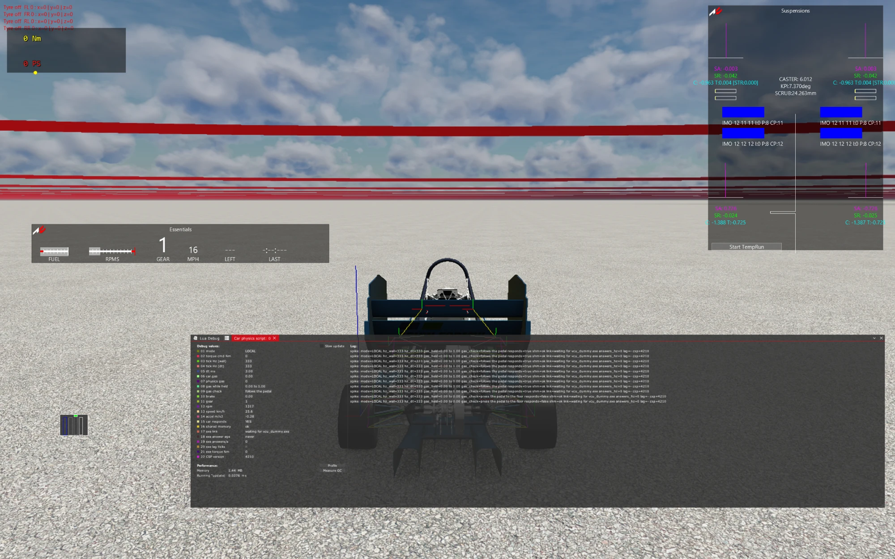
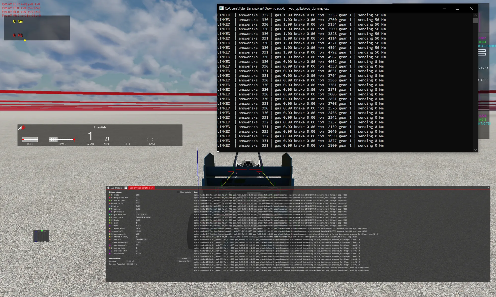

# VCU sim spike: results

**Passed.** Run on 2026-11-16 by Tyler on his Windows PC with Assetto Corsa, CSP 4210,
following [CHECKLIST.md](CHECKLIST.md). `vcu_dummy.exe` connected over shared memory
and its torque drove the car. This proves AC can hand every physics tick to an
outside program and apply the torque it sends back, fast enough to drive on.

What ran was the dummy VCU (a flat 50 Nm past 10% pedal), not real firmware.

## Checklist

| Row | Result | Pass? |
|---|---|---|
| CSP version | 4210 | — |
| `03 tick Hz (wall)` | 333 | ✅ |
| `09 gas check` | follows the pedal (gas 0.00 to 1.00) | ✅ |
| `15 car responds` | YES | ✅ |
| `16 shared memory` | ok | ✅ |
| `17 exe link` | CONNECTED | ✅ |
| `19 exe answers/s` | 330–332 (tick rate 333) | ✅ |
| `20 exe lag ticks` | 1 | ✅ |
| Program window | LINKED, gas follows the pedal, 50 Nm on gas and 0 Nm off | ✅ |

With the program in control, in first gear, rpm went from 2335 to 4962 while it sent
50 Nm and fell when the pedal came up and it sent 0 Nm.

## Screenshots

**Part A, without the program.** `01 mode` is `LOCAL`, 333 Hz, the gas check follows
the pedal, the car responds, shared memory is ok and the link is waiting for the program.



**Part B, with the program.** `01 mode` is `EXE` and `17 exe link` is `CONNECTED`, with
331 answers/s, 1 tick of lag and an answer age of 0 ms. The program window (top right)
shows `LINKED`, the 50 Nm / 0 Nm torque following the pedal and the rpm it produced.



## Not covered

- **Closing the program (Part B step 5).** Not checked, so the fallback to `LOCAL` and
  `17 exe link` showing `LOST` is only covered by CI (`make -C spike test`), not in game.
- **`--sleep` lag test.** Not run.
- **The CSP log cuts off** with "Limit exceeded, truncating the rest" at about 128 s,
  right after the link connected. The rest of Part B is only in the screenshots above.

## Notes

- `hz_wall=4` at about 118 s lines up with a pause or menu (a replay save came right
  after). Harmless.
- The "0 Nm / 0 PS" box in the top left of the screenshots is a separate HUD app
  reading AC's own engine, not the spike's override.

## CSP log (`spike:` lines)

From `Documents\Assetto Corsa\logs\custom_shaders_patch.log`. The first column is
milliseconds since AC started.

```
  7508 spike: mode=LOCAL hz_wall=333 hz_dt=333 gas_held=0.00 to 0.00 gas_check=press the pedal to the floor responds=false shm=ok link=waiting for vcu_dummy.exe answers_hz=0 lag=- csp=4210
 12510 spike: mode=LOCAL hz_wall=333 hz_dt=333 gas_held=0.00 to 0.00 gas_check=press the pedal to the floor responds=false shm=ok link=waiting for vcu_dummy.exe answers_hz=0 lag=- csp=4210
 17511 spike: mode=LOCAL hz_wall=333 hz_dt=333 gas_held=0.00 to 1.00 gas_check=follows the pedal responds=true shm=ok link=waiting for vcu_dummy.exe answers_hz=0 lag=- csp=4210
 22512 spike: mode=LOCAL hz_wall=333 hz_dt=333 gas_held=0.00 to 1.00 gas_check=follows the pedal responds=true shm=ok link=waiting for vcu_dummy.exe answers_hz=0 lag=- csp=4210
 27512 spike: mode=LOCAL hz_wall=333 hz_dt=333 gas_held=0.00 to 1.00 gas_check=follows the pedal responds=true shm=ok link=waiting for vcu_dummy.exe answers_hz=0 lag=- csp=4210
 32513 spike: mode=LOCAL hz_wall=333 hz_dt=333 gas_held=0.00 to 1.00 gas_check=follows the pedal responds=true shm=ok link=waiting for vcu_dummy.exe answers_hz=0 lag=- csp=4210
 37514 spike: mode=LOCAL hz_wall=333 hz_dt=333 gas_held=0.00 to 1.00 gas_check=follows the pedal responds=true shm=ok link=waiting for vcu_dummy.exe answers_hz=0 lag=- csp=4210
 42515 spike: mode=LOCAL hz_wall=333 hz_dt=333 gas_held=0.00 to 1.00 gas_check=follows the pedal responds=true shm=ok link=waiting for vcu_dummy.exe answers_hz=0 lag=- csp=4210
 47517 spike: mode=LOCAL hz_wall=333 hz_dt=333 gas_held=0.00 to 1.00 gas_check=follows the pedal responds=true shm=ok link=waiting for vcu_dummy.exe answers_hz=0 lag=- csp=4210
 52517 spike: mode=LOCAL hz_wall=333 hz_dt=333 gas_held=0.00 to 1.00 gas_check=follows the pedal responds=true shm=ok link=waiting for vcu_dummy.exe answers_hz=0 lag=- csp=4210
 57519 spike: mode=LOCAL hz_wall=333 hz_dt=333 gas_held=0.00 to 1.00 gas_check=follows the pedal responds=true shm=ok link=waiting for vcu_dummy.exe answers_hz=0 lag=- csp=4210
 62520 spike: mode=LOCAL hz_wall=333 hz_dt=333 gas_held=0.00 to 1.00 gas_check=follows the pedal responds=true shm=ok link=waiting for vcu_dummy.exe answers_hz=0 lag=- csp=4210
118354 spike: mode=LOCAL hz_wall=4 hz_dt=333 gas_held=0.00 to 1.00 gas_check=follows the pedal responds=true shm=ok link=waiting for vcu_dummy.exe answers_hz=0 lag=- csp=4210
123354 spike: mode=OFF (not in a forward gear) hz_wall=333 hz_dt=333 gas_held=0.00 to 1.00 gas_check=follows the pedal responds=true shm=ok link=waiting for vcu_dummy.exe answers_hz=0 lag=- csp=4210
128355 spike: mode=OFF (not in a forward gear) hz_wall=333 hz_dt=333 gas_held=0.00 to 1.00 gas_check=follows the pedal responds=true shm=ok link=CONNECTED answers_hz=331 lag=1 csp=4210
```
